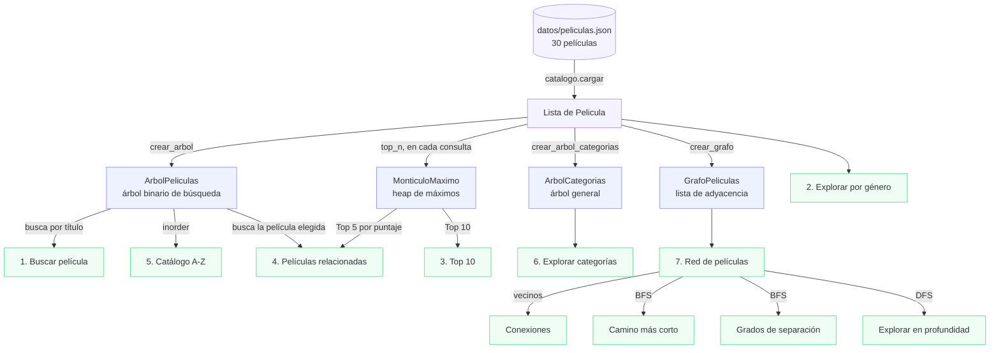
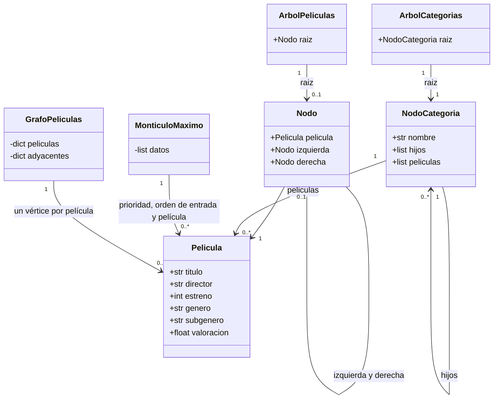

# Diagrama de datos

Este documento muestra cómo viajan los datos por TARSbot y cómo se conectan las estructuras entre sí.

## Conexión entre estructuras

Las películas se leen una sola vez del JSON y quedan en una lista. A partir de esa lista, al iniciar el programa se arman el árbol binario de búsqueda, el árbol de categorías y el grafo. La heap se arma en cada consulta de ranking, porque la prioridad cambia según lo que se pregunta.

El árbol AVL no aparece porque es una pieza de estudio que no está integrada al menú.

## Modelo de datos

La única entidad del dominio es `Pelicula`. Cada estructura la guarda a su manera:

- **Pelicula**: `subgenero` es opcional (vacío en Acción, Animación y Fantasía).
- **Nodo**: cada nodo del árbol binario tiene como máximo dos hijos, y se ordena por título sin distinguir mayúsculas.
- **NodoCategoria**: un nodo puede tener cualquier cantidad de subcategorías y guardar películas propias, por eso es un árbol general.
- **MonticuloMaximo**: una lista donde cada elemento es `(prioridad, orden de entrada, película)`. El orden de entrada desempata, y los hijos del nodo `i` están en las posiciones `2i + 1` y `2i + 2`.
- **GrafoPeliculas**: `peliculas` guarda cada película por título en minúsculas y `adyacentes` guarda, para cada título, un diccionario con sus vecinos y el peso de cada conexión (la afinidad).

## Qué estructura se usa y por qué

n es la cantidad de películas, N la de categorías, V las películas del grafo y E sus conexiones.

| Estructura | Archivo | Dónde se usa | Operación clave | Complejidad | Por qué se eligió |
|---|---|---|---|---|---|
| Lista | `catalogo.py` | Opción 2 y candidatas de las recomendaciones | Recorrer y filtrar | O(n) | Es lo más simple para pasar una vez por todo el catálogo |
| Árbol binario de búsqueda | `arbol.py` | Opciones 1, 4 y 5 | Buscar por título | O(log n), inorder O(n) | Buscar sin recorrer todo y listar de la A a la Z sin ordenar |
| Árbol general | `arbol_general.py` | Opción 6 | Buscar categoría y ubicar película | O(N) y O(N + n) | La jerarquía género y subgénero tiene cantidad variable de hijos |
| Heap | `heap.py` | Opciones 3 y 4 | Construir y extraer el máximo | O(n) y O(log n), Top-N en O(n + N log n) | Sacar los N mejores sin ordenar todo el catálogo |
| Grafo | `grafo.py` | Opción 7 | Vecinos, BFS y DFS | O(V + E) | Las relaciones entre películas forman una red y es poco denso (27%) |
| Árbol AVL | `avl.py` | No está en el menú | Insertar con rotaciones | O(log n) garantizado | Mostrar qué pasa cuando el BST se desbalancea |

Los recorridos de BFS y DFS cuestan O(V + E) y, como los vecinos se ordenan por afinidad antes de visitarlos, suman un factor logarítmico (el detalle está en [11-Recorridos.md](11-Recorridos.md)).

## Dónde se usan BFS y DFS

| Algoritmo | Estructura | Dónde |
|---|---|---|
| BFS (cola) | Grafo | Camino más corto (opción 7.2) y grados de separación (opción 7.3) |
| BFS (cola) | Árbol general | `por_niveles`, que no está en el menú y se muestra en `ejemplo_categorias.py` |
| DFS (recursión) | Grafo | Explorar en profundidad (opción 7.4) |
| DFS (recursión) | Árbol general | Buscar una categoría, ubicar una película y los recorridos preorden y postorden |
| DFS (recursión) | Árbol binario | Los recorridos inorder, preorder y postorder |
